<div align="center">



<a href="https://github.com/muhammadaliyandev"></a>

<br/>

[](https://www.linkedin.com/in/muhammadaliyandev)
[](mailto:muhammadaliyan096@gmail.com)
[](https://muhammadaliyanportfolio.pages.dev)


</div>

<br/>

## ⚡ whoami

```js
const aliyan = {
  name: "Muhammad Aliyan",
  role: "Full-Stack Developer",
  location: "Bahawalnagar, Pakistan 🇵🇰",
  studying: "BS Computer Science (final year) @ IUB, CGPA 3.76",
  agency: "Co-founder of D'zine — web & branding studio",
  stack: ["React", "Node.js", "Express", "MongoDB", "PostgreSQL"],
  exploring: ["n8n AI automation", "RAG chatbots", "Git & GitHub workflows"],
  motto: "Ship it live. Learn from real users.",
  openToWork: true,
};
```

<br/>

## 🚀 Live Products

<table>
  <tr>
    <td width="50%" valign="top">
      <h3>🛒 <a href="https://elegancerepublic.com">Elegance Republic</a></h3>
      Full-stack e-commerce store for premium Pakistani menswear.<br/><br/>
      
      
      
      
      
    </td>
    <td width="50%" valign="top">
      <h3>📱 <a href="https://sunny-mobile-center.pages.dev">Sunny Mobile Center POS</a></h3>
      Mobile-first POS PWA: billing, barcode/IMEI, udhaar ledger and reports. Running live in a real shop.<br/><br/>
      
      
      
      
    </td>
  </tr>
  <tr>
    <td width="50%" valign="top">
      <h3>🤖 ChatSite AI</h3>
      Multi-tenant chatbot SaaS. Paste a URL, it crawls and indexes the site, then answers only from that content (RAG).<br/><br/>
      
      
      
      
    </td>
    <td width="50%" valign="top">
      <h3>💬 OrderWapp / Cafe Doozy</h3>
      WhatsApp ordering CRM for restaurants.<br/><br/>
      
      
      
      
    </td>
  </tr>
</table>

<br/>

## 📌 Featured Repository

<div align="center">

<a href="https://github.com/muhammadaliyandev/d-zine-portal">
  
</a>

<sub>Client portal for a brand studio: questionnaire, logo and palette reviews, stage-wise deliverables.</sub>

</div>

<br/>

## 🛠️ Tech Arsenal

<div align="center">


</div>

<br/>

## 📊 GitHub Analytics

<div align="center">


</div>

<br/>

## 🎓 Journey

```text
2023 ──► BS Computer Science begins @ IUB, Bahawalnagar Campus
2026 ──► Software Development Intern @ AlliedBiztech (Feb – May)
2026 ──► Launching live products: POS, e-commerce, RAG chatbot, WhatsApp CRM
2027 ──► Graduation 🎓
```

<br/>

## 🤝 Let's Build Something

<div align="center">

Need a **website, web app, POS, AI chatbot or WhatsApp automation** for your business?

[](mailto:muhammadaliyan096@gmail.com)
[](https://www.linkedin.com/in/muhammadaliyandev)


</div>
